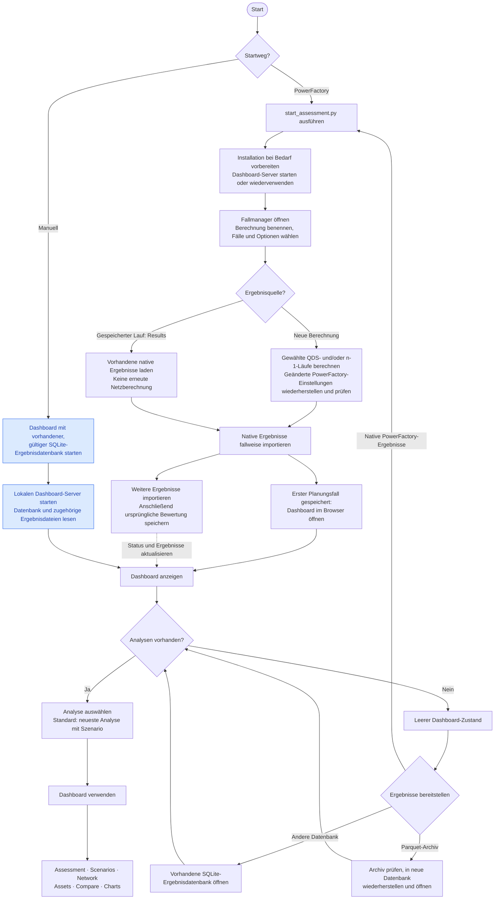

# Ablauf: Berechnung und Dashboard

- Der manuelle Start führt keine PowerFactory-Berechnung aus. Native Ergebnisse werden über den PowerFactory-Fallmanager importiert.
- Datenbankwechsel und Archivoperationen sind nur verfügbar, wenn der Server den lokalen Dateizugriff erlaubt; im Netzwerkbetrieb sind sie standardmäßig deaktiviert.
- Bei neueren Importen gehören die SQLite-Datei und der zugehörige `.values`-Ordner zusammen. Ein vollständiges Parquet-Archiv enthält zusätzlich ein `manifest.json` und die archivierten Tabellen.
- Die ursprüngliche PowerFactory-Bewertung bleibt von der Dashboard-Bewertung mit ihren einstellbaren Grenzwerten getrennt. Bei reinen n-1-Läufen fehlen QDS-abhängige Ansichten.
