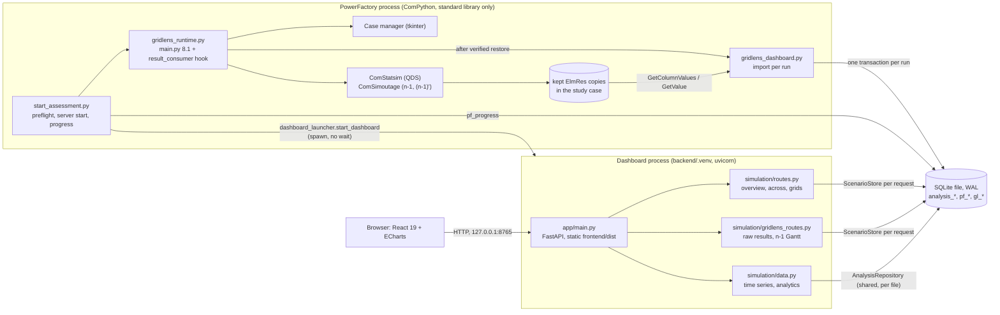
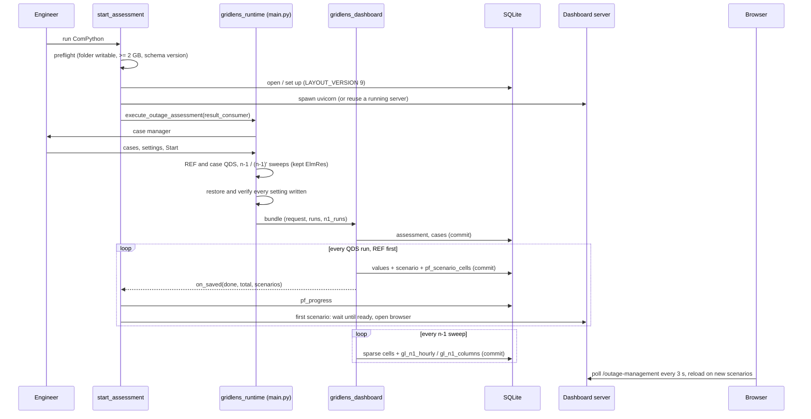

# Architecture (current state)

State of 2026-11-07 (phases 2 and 3 included), traced in the code. It describes what exists; planned extensions are in
`dev.md`.

## Components

No PowerFactory object ever reaches the dashboard process; the only link is the SQLite file. The PDF report path
(main.py below an IntReport) is separate and not part of this repository's flow.

## One run, step by step

## Who writes and who reads which table

| Tables | Written by | Read by |
|---|---|---|
| `analysis_runs`, `analysis_elements`, `analysis_metrics`, `analysis_series`, `analysis_values`, `pf_element_limits`, `pf_run_notes` | bridge (`_read_qds`) | `data.py` (time series, analytics), `across.py` (evaluation, profile) |
| `pf_scenarios`, `pf_scenario_runs`, `pf_jobs`, `pf_scenario_provenance` | bridge (`_save_scenario`) | `across.py`, overview |
| `pf_catalog` (one row) | bridge, replaced by every import | fallback only; `across.py` reads each scenario's own provenance |
| `gl_elements` (master data per analysis) | bridge (`Elements`) | `/facilities/{run}/components` (nominal kV), `/gridlens/assessments/{id}/elements` |
| `pf_scenario_cells` | bridge (`across.prepare_cells`, same transaction as the scenario) | `across.scenario_cells` |
| `pf_progress` | starter | overview banner |
| `gl_assessments`, `gl_cases`, `gl_results`, `gl_columns`, `gl_times`, `gl_time_columns`, `gl_pairs`, `gl_contingencies`, `gl_values` | bridge | `gridlens_routes.py` (raw API) |
| `gl_n1_hourly`, `gl_n1_columns` | bridge (`SweepSummary`) | n-1 Gantt, asset view |
| `pf_run_times` (per run and time: extremes, violation counts) | bridge (`RunTimes`) | time-point view (`timepoint.py`) |
| `pf_lodf`, `pf_lodf_undefined` | nothing (only the test fixture) | LODF parts of the evaluation |

## Dashboard views and their requests

| View | Requests |
|---|---|
| Analysis field | `GET /analyses`; the choice is passed as `?analysis=` to index, evaluation and run list |
| Outage management, progress banner | `GET /outage-management` every 3 s (ETag, 304 when unchanged) |
| Key figures, assessment, voltage, matrix, comparison, radar, detail table | `GET /across-scenarios/index`, then `GET /across-scenarios/cells?ids=…` in growing groups |
| Loading profile | `GET /across-scenarios/{id}/profile` |
| Calculation-status filter (`?status=complete\|problems`) | none: the scenario index carries the worst run status of every scenario |
| Time range (`?from=…&to=…`, UTC) | passed as `start`/`end` to the time course and the asset time series |
| Network at a time | `GET /scenarios/{id}/times?start&end`, `GET /scenarios/{id}/snapshot?t=…` (pages of 50), `GET /scenarios/{id}/restore-package` |
| Asset | `GET /assets/{element}`, then `GET /timeseries/raw/…?start&end` of its REF and scenario component |
| Compare (analysis browser) | `GET /analyses`, `GET /compare/analyses?a&b`, `GET /compare/scenarios?a&b&metric&limit&offset&q` |
| Voltage level field | `GET /voltage-levels` |
| n-1 Gantt | `GET /gridlens/assessments`, `GET /gridlens/assessments/{id}`, `GET /gridlens/results/{id}/n1-gantt` |
| Filters (grid, scenario, equipment, measurement) | `GET /grids`, `GET /facilities`, `GET /facilities/{run}/components`, `GET /components/{id}/measurement-types` |
| Added charts (20 templates) | `GET /timeseries/raw/…` and `/timeseries/aggregate/…`, `GET /analytics/…` |
| Database picker | `GET /capabilities`, `GET /database`, `POST /database` (POST only while not exposed to the network) |

The raw-result endpoints `columns`, `times`, `contingencies` and `series` of `/gridlens/results/{id}` are not used
by the frontend yet.

## Baseline (synthetic, 660 assets, REF + 6 cases, 1 year hourly, 12 n-1 sweeps)

Measured in phase 1 on mains power. A repeat after phase 2 ran on battery in low-power mode and was about 2.0×
slower for every request, including requests whose code did not change (box plot 2.7 → 5.4 ms); the ratio is the
same for the changed paths (index 2.3 → 4.5 ms, evaluation 6.8 → 13.5 ms), so phase 2 shows no measurable
regression. Compare only measurements taken under the same power conditions.

Fresh server process with a warm operating-system file cache; P50/P95 over 20 repeated requests.

| Request | first | P50 | P95 | response |
|---|---|---|---|---|
| Overview | 1 ms | 1.0 ms | 1.2 ms | 39 kB |
| Scenario index | 3 ms | 2.3 ms | 2.3 ms | 2 kB |
| Evaluation of all scenarios (cells) | 11 ms | 6.8 ms | 7.0 ms | 1,209 kB |
| Loading profile | 21 ms | 1.3 ms | 1.3 ms | 60 kB |
| Equipment list of a run | 4 ms | 3.8 ms | 3.9 ms | 165 kB |
| One asset, 1 year raw | 9 ms | 7.0 ms | 7.3 ms | 409 kB |
| One asset, daily maximum | 3 ms | 2.5 ms | 2.7 ms | 17 kB |
| Box plot, one asset | 3 ms | 2.7 ms | 2.8 ms | 3 kB |
| n-1 Gantt (40 branches) | 60 ms | 1.3 ms | 1.4 ms | 113 kB |

## 100,000 elements (phase 3b)

Synthetic run with 100,000 branches and 100,000 busbars, REF and 2 cases over 72 h (43 million values, 2 GB, import
142 s, first case visible after 92 s, peak 950 MB RAM), measured on battery in low-power mode:

| Request | first | warm (P50) | response |
|---|---|---|---|
| Analyses, overview, scenario index | 2 ms | 1.5 ms | ≤ 12 kB |
| Evaluation of one scenario (relevant elements, see below) | 1.9 s | 256 ms | 10.4 MB (1.5 MB gzip) |
| Equipment search, 500 matches / one name | 99 / 127 ms | 106 / 133 ms | 136 / 3 kB |
| Network at a time, one grid (33,000 elements) | 770 ms | 15 ms (cached) | 15 kB |
| Network at a time, all 100,000 elements | 0.98 s first time of a run, then 0.42–0.46 s per new time | 76 ms (cached) | 15 kB |
| Compare two scenarios, 100,000 branches | 1.7 s (reads both evaluations) | 22 ms per page or search | ≤ 60 kB per 200 rows |
| Compare two analyses (checks and scenario pairs) | 0.5 s | cached 10 min | ≤ 20 kB |
| Time course, asset view, restore package | 3–180 ms | 2–183 ms | ≤ 9 kB |
| Grids, voltage levels | 0.9 s / 0.4 s | 1.4 / 15 ms (cached) | < 1 kB |

Above 5,000 elements per scenario the evaluation lists only the relevant elements (`across.relevant_cells`): every
branch switched off, at or above the warning loading, or above a limit at any time; every busbar outside or close to
the band; and the 500 highest loadings, changes and voltage deviations. Verdicts and key figures stay exact (tested);
the dashboard states how many elements are listed. The size follows the number of relevant elements, not the network:
the synthetic load model drives 32 % of all branches above 80 %, real networks far fewer.

## Known limitations of the current state

Resolved in phase 2 (tests: `backend/tests/test_analysis_contract.py`) and phase 3 (`backend/tests/test_timepoint.py`):

- ~~Scenarios of different imports mixed by name, with one global catalog~~: every import is an analysis; the
  dashboard evaluates one at a time and each scenario uses its own provenance.
- ~~Missing values dropped in the time-series API, mean as default reduction~~: gaps carry their state; `MINMAX`
  is the default reduction.
- ~~No nominal voltage stored~~: `gl_elements.nominal_kv`; voltage-level filter in the header.
- ~~PNG export in two chart types only, no CSV~~: PNG for every chart, CSV for the detail table, time point and asset.

Open:

1. The evaluation of a large analysis follows the number of relevant elements (see above); an analysis in which most
   elements are relevant still sends them all.
2. Time series travel as one ISO timestamp string per point.
3. Two access paths to the same file (`ScenarioStore` per request, a shared `AnalysisRepository` per file).
4. Network at a time over all 100,000 elements: 0.98 s for the first time of a run (element master data, then
   cached), 0.42–0.46 s per further time (two value reads in parallel, one key lookup per element).
5. Comparing scenarios pairs elements by id, else by type, grid and name; a renamed element counts as only in A and
   only in B.
6. LODF parts of the dashboard have no data source.
