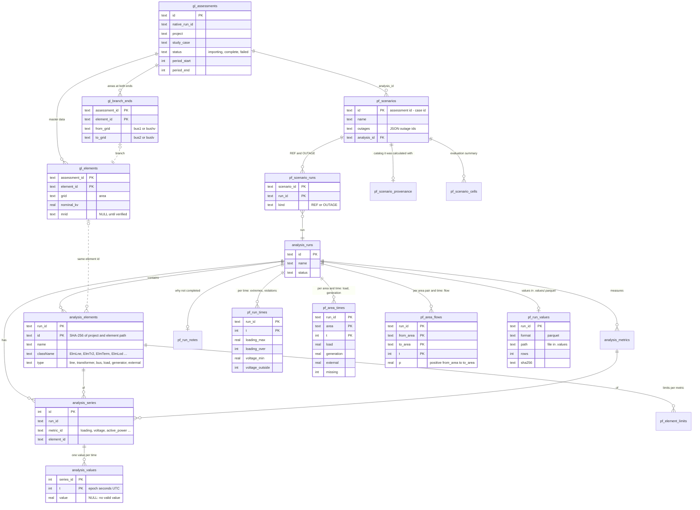
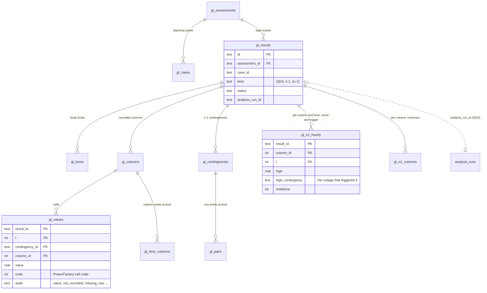

# Results database

The results live in **one SQLite file and the folder of the same name with `.values`** beside it (default
`backend\data\outage-assessment.sqlite3` and `outage-assessment.values\`, configured in
`outage-assessment.config.json`). SQLite holds analyses, scenarios, elements, limits and every summary written at
import; the folder holds the raw QDS values, one immutable Parquet file per run (`pf_run_values` names it, decision
E2, see [STORAGE.md](STORAGE.md)). Both belong together: copy, back up and delete them together. Runs imported
before layout 14, and databases restored by older releases, keep their values in `analysis_values`; the
dashboard reads both. New archive restorations retain Parquet. PowerFactory writes native results; the local
dashboard can additionally import explicit Redispatch deliveries through the same serialized write lock.
The SQLite file uses WAL mode, so reading never blocks the script and the script never blocks a reader.

Layout version: **18** (`PRAGMA user_version`; results schema 2 in `schema_migrations`). The tables are defined in
`backend/app/analysis/migrations/002_analysis.sql` (results), `backend/app/simulation/store.py` (PowerFactory bridge,
summaries, views) and `backend/app/simulation/gridlens_store.py` (analyses, master data, native results). An older
file is brought up to date once when it is opened. Layout 18 adds `rd_imports` and `rd_hours`, defined in
`backend/app/simulation/redispatch.py`: immutable delivery revisions and supplied hourly MWh, EUR/MWh and exact
signed costs. These are distinct from native power-flow measurements and included in analysis archives.
The import contract is described in [REDISPATCH.md](REDISPATCH.md).

## Overview

Three groups of tables: the **analysis** of one PowerFactory run with its scenarios and QDS values (diagram 1), the
**native results** of the run as PowerFactory kept them, above all the n-1 sweeps (diagram 2), and a few
**operational** tables (diagram 3). Solid lines are foreign keys; dashed lines are links by the same identifier
(the element id is the same hash in `analysis_elements`, `gl_elements` and `gl_columns`).

### 1 · Analysis, scenarios, runs and values



`analysis_values` (series × time → value) keeps the values of runs without a `pf_run_values` row; a run file has the
same three columns (`series_id`, `t`, `value`), in row groups of 1,000 series × one week.

### 2 · Native results (QDS runs and n-1 sweeps as PowerFactory kept them)



### 3 · Operational tables (no links)

`pf_jobs` (calculation requests; one per scenario id), `pf_progress` (what the script is doing right now),
`pf_catalog` (last import's catalog, fallback only), `pf_lodf` / `pf_lodf_undefined` (by `outage_key`, no data
source in the current workflow), `schema_migrations` (results schema version).

A **scenario** is one named planned-outage case. It has two **runs**: `REF` (every planned outage
disabled) and `OUTAGE` (its planned outages enabled). All scenarios of one calculation share the same
REF run: it is stored once and linked to each of them.

## Tables

### Results

| Table | One row per | Columns |
|---|---|---|
| `analysis_runs` | run | `id`, `name`, `project`, `study_case`, `source`, `status` |
| `analysis_elements` | element of a run | `run_id`, `id`, `name`, `className` (ElmLne, ElmTr2, ElmTerm, ElmLod …), `type` (line, transformer, bus, load, generator, external), `path` (full PowerFactory path) |
| `analysis_metrics` | measured quantity of a run | `run_id`, `id` (loading, voltage …), `name`, `unit`, `lower`, `upper` |
| `analysis_series` | time series: run × metric × element | `id` (integer), `run_id`, `metric_id`, `element_id` |
| `analysis_values` | value of a series at one time | `series_id`, `t` (epoch seconds, UTC), `value` (`NULL` = no valid value, e.g. a de-energised busbar) |

### PowerFactory bridge

| Table | Content |
|---|---|
| `pf_catalog` | one row: project, Study Case, simulated period and every planned outage (JSON) as seen by the **last** import. The dashboard uses the provenance of each scenario instead; this row is only a fallback for scenarios without one |
| `pf_jobs` | calculation requests and their outcome (`completed`, `failed`, message) |
| `pf_scenarios` | saved scenarios: `id`, `name`, project, Study Case, `outages` (JSON list of outage ids), `created_at`, `analysis_id` (the analysis it belongs to; NULL for scenarios saved without one) |
| `pf_scenario_runs` | `scenario_id`, `run_id`, `kind` (`REF` / `OUTAGE`) |
| `pf_scenario_provenance` | per scenario the catalog it was calculated with (JSON): project and Study Case paths, period, run period, its planned outages with windows and equipment, settings, `assessment_id` |
| `pf_element_limits` | voltage band per busbar and run: `lower`, `upper` |
| `pf_run_notes` | only for a run that is not `completed`: `status` (`not_converged`: the calculation ended with an error code and the results stop there; `incomplete`: time points without any value) and the explanation `note` |
| `pf_scenario_cells` | per scenario the dashboard's summary (reduced values per element, JSON), prepared by the script right after it saved the scenario, so the first view does not read every value again (measured: 23 ms instead of 780 ms per scenario with 455 series × 8,784 h). Used only while it matches the loading limits and the LODF it was made with; otherwise the dashboard reduces the values itself. Can be deleted at any time |
| `pf_lodf` | `outage_key`, `element_id`, `lodf` (signed fraction at the bus1 side), `p_pre`, `p_post`, `computed_at`; the current PowerFactory workflow fills it no more (no LODF is calculated), the dashboard then shows "not calculated" |
| `pf_progress` | one row: what the script is doing right now (`state` running / finished / failed / stopped, `step`, `detail`, `current` of `total` scenarios, `started_at`, `updated_at`); the dashboard shows it as a banner while the script calculates |
| `pf_lodf_undefined` | `outage_key`, `reason`: outages whose LODF is not defined (no contingency, no solution, no equipment), see [ASSESSMENT.md](ASSESSMENT.md) |

### Analyses (layout 10)

Every import of a PowerFactory run is one **analysis** (`gl_assessments`). The dashboard shows the scenarios of one
analysis at a time, by default the newest one that has a scenario (`GET /api/simulation/analyses`); scenarios of
different imports are never evaluated together. Columns added in layout 10: `status` (`importing`, `complete`,
`failed`; `unknown` only for imports before layout 10), `source_system`, `calculation_types` (JSON list such as
`["QDS","n-1","(n-1)'"]`), `project_path`, `study_case_path`, `created_by`, `period_start`, `period_end` (epoch seconds
of the period the runs covered) and `result_schema_version` (4; 1/2/3 for earlier imports).

`gl_elements` holds the master data of every monitored element of an analysis: `element_id` (the internal key below),
`name`, `class_name`, `path`, `grid`, `nominal_kv` and `mrid`. `mrid` stays NULL until a verified source supplies the
CGMES mRID; nothing is guessed.

A file of layout 9 is brought to layout 10 when it is opened: the new columns are added, every scenario gets the
analysis named in its provenance, and each analysis gets its result kinds, paths, period and a status inferred from
its cases (`failed` when a case is marked `IMPORT FAILED`). Master data is not invented for earlier imports.

### Time summary (layout 11)

`pf_run_times` holds per QDS run and time the highest branch loading (`loading_max`), how many branches exceed their
limit (`loading_over`), the lowest and highest node voltage (`voltage_min`, `voltage_max`) and how many nodes leave
their band (`voltage_outside`), with the limits of `pf_element_limits`. The bridge writes it while it imports the run
(about 1 s per run of 660 series over a year); the time-point view reads it by key. For runs imported before layout 11
the dashboard aggregates the same figures from the stored values once (a few seconds) and keeps them in memory.

### Areas (layout 13)

`pf_area_times` holds per QDS run, area (grid) and time the summed active power of loads, generators and external
grids (NULL when the area has no such element recorded) and how many of its series had no valid value;
`pf_area_flows` the summed active power of the branches between two areas, positive from `from_area` to `to_area`.
`gl_branch_ends` records the grids at both ends of every branch, read from its terminals at import. The bridge writes
all three while it imports a run, only for what PowerFactory recorded; see [AREAS.md](AREAS.md).

Layout 12 adds the index `analysis_elements_name (run_id, name)` for the equipment list in name order and the
switched-off equipment of a scenario (100,000 elements: from 970 ms to 1.5 ms for the scenario index).

### States

Every value the API cannot give as a number carries a state from one versioned catalogue
(`backend/app/simulation/states.py`, `GET /api/simulation/states`): cell states such as `invalid_or_missing`
(NULL in `analysis_values`), `not_recorded` (n-1, PowerFactory code 3), `missing_row`, `missing_column`, `invalid`,
`read_error`; element state `outaged`; result, case and analysis states. A missing value is never 0.

### Identifiers

| Identifier | Built from | Stable across |
|---|---|---|
| element `id` | SHA-256 of `<project path>|<element path>` | all runs and calculations of one project; renaming or moving the element in PowerFactory starts a new identity. The CGMES mRID (`gl_elements.mrid`) is kept beside it once a verified source supplies it |
| outage id | SHA-256 of the planned outage's PowerFactory path | all calculations |
| `outage_key` | the sorted outage ids of a scenario, comma-separated | scenarios with the same outages |
| run `id` | random per stored run (REF and every case); a scenario is `<assessment id>-<case id>` | – |

The grid (ElmNet) of an element is the folder name before `.ElmNet` in its `path`
(`…\D7 Grid.ElmNet\L1.ElmLne` → `D7 Grid`); the views below provide it as the column `grid`.

## Why it is built this way

Almost all of the file is `analysis_values`: about 455 series × 8,760 hours × 21 runs ≈ 84 million
values for a year. Each value is therefore stored as three numbers only, in key order:

- `analysis_series` gives every series a short integer key; the long text identifiers (run, metric,
  64-character element hash) are stored once per series instead of once per value.
- Times are epoch seconds (an integer), not text.
- `analysis_values` is a `WITHOUT ROWID` table: the table *is* its key order, so one series is one
  contiguous range on disk and no second copy of the key exists.

Measured with 7.1 million values (455 series × 744 hours × 21 runs):

| | schema 1 | schema 2 |
|---|---|---|
| file size | 3,069 MB (430 bytes per value) | **179 MB (25 bytes per value)** |
| scenario list / equipment dropdown | 1,000 ms (read every stored value) | **< 1 ms** |
| loading statistics of one run (core of the key figures) | 95 ms | **48 ms** |
| one time series (SQL) | 0.26 ms | 0.20 ms |
| saving one scenario (338,000 values) | – | 0.44 s |
| dashboard request while the script saves | waited for the write lock (up to 30 s) | **answers at once** |

Opening the file never writes: the schema is set up once per file (tracked in `PRAGMA user_version`).

## Reading the results with other tools

The file can be read while the dashboard runs. Open it **read-only**, never write to it by hand.

### Views

| View | One row per | Use |
|---|---|---|
| `v_scenarios` | scenario | name, outages, the ids of its REF and OUTAGE run |
| `v_planned_outages` | planned outage of the last run | name, equipment, window in UTC, whether it lies in the simulated period |
| `v_elements` | element of a run | name, class, type, grid, path |
| `v_series` | time series | run, metric, unit, element, grid |
| `v_runs` | calculated run | run, `case_kind`, `status` (`completed`, `not_converged`, `incomplete`), `note`, number of linked scenarios (0: a REF saved before its scenarios) |
| `v_run_storage` | run | storage format, relative Parquet path, row count, bytes and SHA-256; NULL file fields for SQLite |
| `v_samples` | SQLite value only | scenario (NULL for a REF no scenario links to yet), `case_kind` (REF/OUTAGE), element, grid, metric, unit, `timestamp_utc`, `epoch`, `value` |
| `v_lodf` | LODF value | scenario, element, grid, `lodf`, `p_pre`, `p_post` |
| `v_lodf_undefined` | scenario without LODF | scenario, reason |

Filter `v_samples` at least by scenario and element (or metric). It holds the values stored in SQLite only; the
values of runs in `pf_run_values` are Parquet files any Parquet reader opens (DuckDB, pandas, Power BI, Excel via
Power Query), with `series_id` joining `analysis_series`.

### Complete access across SQLite and Parquet (layout 15)

`v_samples` cannot read Parquet through SQLite. Use the common `values.query()` / `values.iter_query()` for SQL
on one run, or `values.iter_samples()` for the complete named sample stream, including mixed databases.
`iter_samples` yields the same columns and scenario multiplicity as `v_samples`: shared REF runs appear for each
linked scenario, while an unlinked run has NULL scenario and case kind REF. Do not sum shared references across
scenarios as independent measurements. NULL values remain NULL. Filter by run/scenario and `[start, end)` UTC
epoch seconds. Batches bound Python output memory; a sorted DuckDB query may still use its own working memory.

```sh
backend/.venv/bin/python scripts/read_values.py /absolute/results.sqlite3 --format csv > samples.csv
backend/.venv/bin/python scripts/read_values.py /absolute/results.sqlite3 --run RUN_ID --start 1767225600 --end 1767312000 --format jsonl
```

The CLI opens a read-only SQLite transaction for a consistent snapshot. CSV uses an empty value field for NULL;
JSON Lines uses `null`. It never creates a database or writes a second value store.

```python
import sqlite3
from contextlib import closing
from app.simulation.values import iter_samples

with closing(sqlite3.connect('file:/absolute/results.sqlite3?mode=ro', uri=True)) as db:
    db.execute('BEGIN')
    for sample in iter_samples(db, scenario_id='SCENARIO_ID', batch_size=16384):
        consume(sample)  # stream to the consumer; avoid list(...) for large exports
```

The following SQL/pandas examples query **SQLite values only**. Check `v_run_storage` first or use the complete
CLI above for new imports. Layout 14 → 15 adds the storage view without moving or rewriting values. Analysis
schema and result contract remain at version 2; Redispatch remains an open work item.

### Examples (SQL)

```sql
-- all scenarios with their outages
SELECT scenario, outage_ids, created_at FROM v_scenarios ORDER BY created_at;

-- REF and OUTAGE loading of one line in one scenario
SELECT case_kind, timestamp_utc, value FROM v_samples
WHERE scenario = 'NE_L1' AND element = 'Line A' AND metric = 'loading'
ORDER BY timestamp_utc, case_kind;

-- highest loading per element of one grid in one scenario
SELECT element, MAX(value) AS max_loading FROM v_samples
WHERE scenario = 'NE_L1' AND case_kind = 'OUTAGE' AND grid = 'D7 Grid' AND metric = 'loading'
GROUP BY element ORDER BY max_loading DESC LIMIT 10;

-- the largest |LODF| per scenario
SELECT scenario, element, lodf FROM v_lodf l
WHERE abs(lodf) = (SELECT MAX(abs(lodf)) FROM v_lodf WHERE scenario = l.scenario);
```

### Python (pandas)

```python
import sqlite3, pandas as pd
db = sqlite3.connect("file:C:/LocalData/outageAssessment/backend/data/outage-assessment.sqlite3?mode=ro", uri=True)
df = pd.read_sql("SELECT case_kind, timestamp_utc, value FROM v_samples "
                 "WHERE scenario=? AND element=? AND metric='loading'", db, params=("NE_L1", "Line A"))
```

### sqlite3 command line, DB Browser for SQLite

`sqlite3 -readonly outage-assessment.sqlite3` or the portable *DB Browser for SQLite* (open with
"Read Only"). Both run without installation rights. Excel and Power BI need an SQLite ODBC driver,
which usually has to be installed by IT; the Python route above writes a CSV for Excel without one
(`df.to_csv("result.csv", index=False)`).

## Backup

Copying the SQLite file while the dashboard runs is not safe (WAL). Use
`sqlite3 outage-assessment.sqlite3 ".backup backup.sqlite3"`, or stop the dashboard first
(`stop-dashboard.cmd`) and copy the file. **Copy the folder `outage-assessment.values` as well** (as
`backup.values` beside the copy): its files are never changed once written, so a plain copy is consistent.

## Rebuilding

The results can always be calculated again from PowerFactory, so the file is never migrated:

- A file written by an earlier schema version is refused with a clear message, by the PowerFactory
  script before it calculates anything and by the dashboard.
- To start over: `stop-dashboard.cmd -DeleteDatabase` (stops the dashboard, then deletes the file after
  a confirmation), then run `start_assessment.py` in PowerFactory. It creates a new, empty file.
- When the schema changes, `SCHEMA_VERSION` in `backend/app/analysis/schema.py` is raised together
  with the schema file; views and bridge tables are versioned by `LAYOUT_VERSION` in
  `backend/app/simulation/store.py` and are brought up to date automatically when a file is opened.

## Interrupted imports

The bridge owns `<database>.import.lock` using an OS file lock (Windows byte lock / Unix flock). The file stays
in place and records diagnostic owner details; an old file by itself does not mean an import is running. A second
import fails immediately with a retry message. Dashboard readers do not acquire this lock.

After the next importer acquires ownership it marks interrupted `importing` assessments as `failed`, marks
unstored cases `IMPORT FAILED`, and removes generated UUID/hash Parquet/sidecar/partial files absent from
`pf_run_values`. Committed runs and unrelated files remain. Reimport the kept native results through the case
manager; this appends a new assessment and retains the partial earlier analysis for audit.

A raw file and sidecars become final before their SQLite commit. A crash can therefore leave orphan files, but
cannot publish a completed run before its files exist. Recovery is an explicit import operation, never a side
effect of a dashboard read. Use the same serialized owner for any future external importer. Network-share locking
and native Windows process termination remain acceptance checks; no multi-host writer guarantee is claimed.

Archive restore stages the database and `.values` folder, validates schema/checksums, raw series ownership,
duplicate keys, foreign keys and integrity, then publishes the folder before the database under the destination
import lock. Existing files/folders are refused. Handled failures remove the staged output. A hard process/power
failure may leave a hidden `.restore-*` staging folder or a destination `.values` folder without a database;
inspect/remove that orphan folder before retrying the same restore destination. Existing databases are never
overwritten.


Layout 16 adds `gl_evaluations(assessment_id, case_id, payload)` for original 8.2 source verdicts,
n-0 episodes with locations, and n-1 statistics. Analysis schema remains 2; the native result contract is 3.
Existing layouts upgrade without rewriting values. Archives include evaluations; older contract-2 archives
remain restorable without this optional table. Original evaluation status is separate from native import
success: `evaluating` blocks archiving until the assessment becomes `complete`.


Layout 17 / native result contract 4 adds `gl_unresolved_rows(result_id,t,row_index,diagnostic,cells)`.
These are native contingency rows with unreadable identities, kept independently from identified
`gl_contingencies`, `gl_pairs` and `gl_values`. Their native result has status `incomplete` and metadata
`unresolved_rows`; the original n-1 evaluation stays NOT EVALUATED. Archives include the diagnostic rows;
contract-2/3 archives without this optional table remain compatible. Names of complete calculations are
stored in `gl_assessments.configuration.analysis_name` and exposed as `name` by the analysis APIs.
