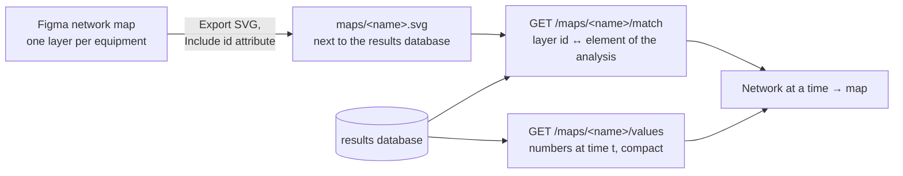

# Network map (from Figma)

## Required files and Figma export

Besides the SVG drawing, the dashboard needs the results database (`.sqlite3`) containing equipment master
data, analyses and scenarios. For runs stored in Parquet, copy the corresponding `<database-stem>.values/`
folder too, retaining its relative location next to the database. A complete analysis archive is the alternative
supported transfer format. Redispatch additionally requires the hourly energy/price CSV described in
[REDISPATCH.md](REDISPATCH.md). The SVG alone contains no simulation or cost results.

Figma Design supports this export: select the map frame, choose SVG in Export, open advanced export settings
and enable **Include “id” attribute**. Keep equipment as separate vector layers, with one named child per item
under **Elements** (or **Generators** for plants). Names must match PowerFactory equipment names, qualified
grid/name or full paths. With matching names no separate mapping file is required. Keep the voltage colours
in the drawing. Export the complete frame rather than a flattened screenshot. Figma exports geometry and layer
IDs; the recorded hourly values come from the result database, and supplied Redispatch data from CSV.
See [Figma's export documentation](https://help.figma.com/hc/en-us/articles/13402894554519-Export-formats-and-settings-for-static-designs).

## Hover comparison and emphasis

Hovering equipment opens a scrollable table of **all its recorded QDS metrics at the selected exact timestamp,
across every scenario**. Each metric includes unit, REF and delta. Generators additionally show their own hourly
Redispatch MWh, price and cost, independent of the map's colouring mode. Missing values are dashes; offline
equipment is labelled. This is an equipment comparison, not network-wide costs or N-1 contingency summaries.
Move the pointer into the table to read/scroll it; Escape dismisses it. Clicking equipment selects it and also
opens the comparison. Requests are debounced, cancelled on equipment/time changes and briefly cached; only the
hovered equipment's exact samples are read. The API is `GET /network/equipment-at-time?element=...&t=...&analysis=...`.

Heatmap contrast defaults to **Dezent**, with narrow backgrounds and stronger emphasis only for critical values.
**Stark** increases opacity moderately. Hover adds a thin, translucent white-separated dark contour; selection adds a thin blue contour, both
behind the original SVG strokes. Transparent hit areas make thin lines easier to hover/click. `?contrast=normal`
keeps the softer setting in a link. Neither contrast nor outlines replace voltage-level colours.

## Map colouring, focus mode and loading another map

The original SVG stroke/fill colours are preserved, including the operator's voltage-level colours. A separate,
wide translucent background below all equipment shows the heatmap: **Auslastung** uses loading bands for branches
and voltage bands for busbars; **Kosten** uses signed hourly Redispatch cost behind generators. Larger amounts
have stronger colour, positive costs are red, negative costs turquoise, zero is neutral, missing values have no
heat background. The cost scale is shared by all scenarios at the selected hour. Filtered equipment is dimmed
without replacing its colours. The separate time heatmap remains available under **Zeitvergleich**.

**Karten-Vollmodus** hides the equipment inspector and lower analysis sections so the drawing fills the available
space. Scenario selection, colouring and the clock remain visible. Exit with the same button or Escape. It also
requests browser fullscreen where supported; the map-only layout works without browser fullscreen. **Details
ausblenden** can hide the right inspector independently.

Open **Karten hinzufügen / Speicherort** below the map controls to see the actual folder of the current database.
Copy another SVG into it (for example `nord.svg`, `sued.svg`), click **Karten neu laden**, then choose it in **Karte**.
Reload also refreshes an overwritten drawing. No server restart is needed. `?map=nord` keeps the map in a link;
`?layer=cost&focus=map` opens cost colouring in map-only mode.

The **Netzkarte** link opens `/network`, a standalone map page with an inspector across all scenarios, exact UTC
time navigation, a scenario/time heatmap and generator Redispatch costs. A map click selects equipment without
leaving the page. Heatmap clicks choose the scenario and the actual peak timestamp; the slider, previous/next-hour
buttons and date/time field update the map, inspector and costs together. Large heatmap windows retain peaks;
the slider uses the complete clock. Missing measurements remain missing. See [REDISPATCH.md](REDISPATCH.md).

Generator symbols can be grouped in **Generators**, one child group with an id per PowerFactory generator, using
the same name/grid/path matching as **Elements**. Alternatively put them directly in **Elements**. Their recorded
active power is shown in MW; imported costs are labelled per generator and hour. Generators without a matching
SVG layer remain available in the table and selector. The IEEE39 example now includes ten source symbols.

The dashboard places result backgrounds behind the operator's own network map for one scenario at one time:
branches (lines, transformers) by loading, busbars by voltage, switched-off equipment dashed with no heat. The map is drawn in Figma and
exported as SVG; the dashboard never contacts Figma.

## Drawing the map in Figma

1. Put every piece of equipment into a group named **`Elements`**. Each layer in it is one element: a line is
   a path, a transformer a group (for example two circles and its connections), a busbar a rectangle or thick line.
2. Name each layer like the PowerFactory element: its name (`Line 01 - 02`), or, when the same name exists in
   several grids, the grid and the name (`Area West Line 01 - 02`), or its full path. Case, spaces and punctuation
   do not matter (`Line_01_-_02` matches `Line 01 - 02`).
3. Background, free labels and legends stay outside `Elements`; they are drawn but not coloured. Generator
   symbols can instead use one named child group each under `Generators`. Keep free labels outside the equipment
   layers, so their geometry is not included in result backgrounds.
4. Export the frame as **SVG** with **Include id attribute** and save it as `maps/<name>.svg` in the folder of the
   results database (or in the folder named by `OA_MAP_DIR`). Several maps are offered in a list.

The heat background follows equipment geometry, including nested transforms, and cannot intercept clicks.
Original strokes, fills and labels retain their SVG colours. Only result backgrounds follow the loading bands
of the dashboard (Limits dialog) and the voltage band of the run. In the separate IEEE39 workspace demo the SVG
includes a voltage legend (345 / 230 / 138 / 16.5 kV); operator SVGs are never rewritten to this demo palette.

## In the dashboard

The map is optional and hidden by default: the button **Network map** in the section **Network at a time** shows
or hides it, and the browser remembers the choice. While it is hidden nothing of it is loaded (no code, no SVG,
no values), so the dashboard is exactly as fast as without a map.

Choose a scenario and a time (critical times or the time course). The map shows that time; hover shows name, grid,
nominal voltage and the exact across-scenario values described above; a click opens the
element in the **Asset** view. Wheel or +/− zooms, dragging moves, **Fit** resets. Below the map the dashboard lists
layers without an element, names that exist in several grids, repeated layer names (Figma appends `_2`) and
elements of the analysis that have no layer.

## Speed

Historical measurements before the separate background layer, with a synthetic map of 20,000 equipment layers (10,000 branches, 10,000 busbars, 1.9 MB SVG, about
60,000 SVG nodes) in headless Chromium on an Apple M5, server on the same machine:

| Step | Time |
|---|---|
| Map visible after opening the section (SVG, match, values, drawing, colours) | 0.92 s |
| Next time (values of 20,000 elements + recolouring) | 0.19 s |
| Zoom (wheel, 40 steps) and hover | no frame over 25 ms, no long task |
| Move (drag) | no frame over 25 ms while moving; one frame of 40–50 ms when grabbing (the browser finds the element under the pointer) |

The drawing and background geometry are inserted once per map; a new time changes only background colours/visibility; zoom and
move change one `translate3d` transform per frame on a compositor layer, without React rendering, and the browser
redraws it sharp after a zoom off the main thread. The server matches layers once per map file and analysis (cache),
and sends the values of a time as compact columns in the order of the matched elements (550 kB raw for 20,000
elements, a few kB compressed) instead of one object per element. Before these changes the same map took 4.5 s to
appear and stalled 90–120 ms at the start and end of every zoom or move.

Controls: wheel or trackpad pinch zooms around the pointer, drag moves, double-click zooms in (Shift: out),
two-finger pinch on touch screens, +/− around the centre, **Fit** resets.

## Safety

The SVG is checked before use: a file with a DOCTYPE or entity declarations is refused (Figma writes none), the
browser removes scripts, embedded documents, event handlers and links out of the file before showing it, and the
server sends the raw file only with a policy that forbids scripts.

## Example

`scripts/try_example.sh` builds the IEEE 39-bus transmission system (39 busbars, 34 lines, 12 transformers;
topology public, loadings and planned outages synthetic) through the real import path, writes its map in the
Figma export format to `backend/data/ieee39-example/maps/ieee39.svg` and opens the dashboard. Drag that SVG into
Figma to see the expected layer structure, change it, and export it back.

## Limits

- The map is static: positions come from the drawing, not from PowerFactory.
- Measured up to 20,000 equipment layers (see Speed). Far larger maps should be split per grid or voltage level.
- Geographic routes (a JSON of line routes) are not supported yet; they would use the same matching.
