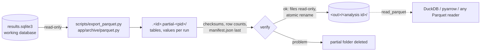
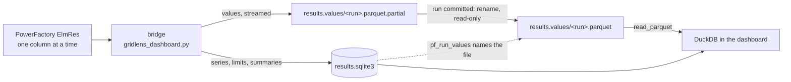

# Storage: SQLite working database, Parquet archive (phase 4)

The dashboard reads one SQLite file per results database. Phase 4 adds an immutable Parquet archive per analysis
and measures SQLite against DuckDB on that archive for the queries of the performance targets. This page has the
measurements, the projection to the target size and the resulting decision E2.

## Archive of one analysis



```
python scripts/export_parquet.py --db results.sqlite3 --out D:/archive            # newest complete analysis
python scripts/export_parquet.py --db results.sqlite3 --analysis <id> --out D:/archive
python scripts/export_parquet.py --verify D:/archive/<id>
```

- **Content:** every row of the analysis: master data (`elements`, `run_elements`, `element_limits`, `series`),
  scenarios with provenance, runs and their status, the per-time summary (`run_times`), all QDS values
  (`analysis_values/<run>.parquet`, ordered by series and time) and all n-1 tables (native cells with code and
  state, `n1_hourly`, `n1_columns`). Format 2 also includes cached evaluations, jobs, catalog and relevant LODF records.
- **Values as stored:** a value PowerFactory did not deliver stays NULL (state `invalid_or_missing`), never 0.
  Times are epoch seconds UTC (`manifest.json` says so).
- **Format:** Parquet, ZSTD level 3, streamed batches / row groups of up to 250,000 rows with min/max statistics, column types from the
  SQLite declaration (INTEGER → int64, REAL → float64, else string).
- **Manifest:** format and version, analysis id, creation time, source file with layout and result-schema
  version, states version, and per file the table, run, row count, size, SHA-256 and columns. It is written last:
  a folder without `manifest.json` is incomplete.
- **Immutable:** written to a hidden partial folder, verified (sizes, SHA-256, row counts, no unlisted file),
  made read-only and renamed into place. An existing archive is never overwritten; an analysis that is still
  importing is refused. `--verify` repeats the check at any time.
- **Dependency:** pyarrow, only for the archive (`pip install "./backend[archive]"`); the dashboard and the
  PowerFactory side do not need it.

Tests: `backend/tests/test_archive.py` (every value identical to the database including NULL, ZSTD, n-1 code and
state kept, immutable, changed byte and extra file detected, unknown and importing analyses refused).

## Save and reopen in the dashboard

Open the database icon in the header, then **Save Parquet**. Enter an absolute parent folder on the dashboard server;
the selected complete analysis is saved below it. Keep the **entire analysis folder**, including `manifest.json` and
all `.parquet` files. This multi-table archive preserves the analysis relationships that one raw Parquet file cannot.

To return later, choose **Reopen Parquet**, enter that analysis folder and a **new absolute SQLite database path**,
then **Restore and open**. The dashboard validates the archive, restores its stored data and summaries in batches,
switches databases and restores the saved browser view/URL filters/custom limits where present. No PowerFactory run
or numerical processing is repeated. Use **Open SQLite** to reopen that restored database on subsequent visits.
Directories are on the server's filesystem; this is not a browser upload/download. Large restores can take minutes;
the dialog stays busy while streaming. Failed validation leaves the current selection intact.

CLI equivalent:

```sh
python scripts/export_parquet.py --restore /absolute/archive/analysis-id --db /absolute/new-results.sqlite3
```

Install `pip install "./backend[archive]"` to enable Parquet. Local filesystem operations follow the database-switch
capability and are disabled in production by default. Archives with incompatible schema/layout/state versions or
missing/corrupt payloads are rejected with an explanation. Version 1 archives with matching versions can reopen;
they lack browser context and their evaluations may require a first-read rebuild. Existing files are never overwritten.
See [the review, implementation and measured results](PERFORMANCE.md) for this update.

## Benchmark

`backend/tests/storage_benchmark.py --db <file> --archive <archive>` runs the same queries on SQLite (as the
dashboard opens it: read-only) and on DuckDB 2.0 over the archive, each engine in its own process. Both engines
must return the same rows (count and sums), otherwise the benchmark fails; they did in every run below.

Machine: Apple M5, 10 cores, 24 GB, mains power, SQLite 3.50.4, DuckDB 2.0.0 (all cores), pyarrow 26.0.1.
Times in ms: first call in a fresh process / P50 / P95 / CPU per call. The operating-system file cache was warm
for both engines; a cold cache cannot be produced without administrator rights (`purge`), so "first" is a fresh
process, not a cold disk.

### 100,000 branches and busbars, 3 runs, 72 h (43.8 million values)

SQLite 2,070 MB · Parquet archive 126 MB (export 21 s, 597 MB peak memory). Peak memory of the benchmark process:
SQLite 396 MB, DuckDB 290 MB. DuckDB opens the archive in 71 ms.

| Query (one run) | rows | SQLite | DuckDB + Parquet |
|---|---|---|---|
| One asset, whole period | 73 | 0.4 / 0.0 / 0.0 / 0 | 11.8 / 8.2 / 8.4 / 11 |
| All elements at one time | 100,000 | 151 / 127 / 128 / 127 | 41 / 38 / 39 / 123 |
| Highest loading per branch in an outage window | 100,000 | 226 / 227 / 227 / 226 | 43 / 41 / 42 / 130 |
| Top 100 branches by highest loading | 100 | 361 / 360 / 362 / 359 | 30 / 26 / 26 / 135 |
| Per time: highest loading, branches above limit | 73 | 3,624 / 3,675 / 3,725 / 3,670 | 39 / 35 / 35 / 153 |

### 200 branches and busbars, 4 runs, 4,873 hourly steps (7.8 million values, 136,000 n-1 cells)

SQLite 231 MB · Parquet archive 60 MB (export 3.3 s, 242 MB peak memory). Peak memory: SQLite 80 MB, DuckDB 176 MB.

| Query (one run) | rows | SQLite | DuckDB + Parquet |
|---|---|---|---|
| One asset, whole period | 4,873 | 1.8 / 0.8 / 0.8 / 1 | 3.9 / 2.3 / 2.4 / 3 |
| All elements at one time | 200 | 10.5 / 0.1 / 0.1 / 0 | 5.3 / 4.4 / 4.7 / 25 |
| Highest loading per branch in an outage window | 200 | 32 / 10.6 / 10.7 / 11 | 4.5 / 4.2 / 4.4 / 16 |
| Top 100 branches by highest loading | 100 | 59 / 30 / 31 / 30 | 4.3 / 4.2 / 4.4 / 16 |
| Per time: highest loading, branches above limit | 4,873 | 256 / 257 / 258 / 257 | 8.7 / 8.4 / 8.8 / 26 |
| n-1: worst value and contingency per column | 265 | 8.9 / 8.2 / 8.3 / 8 | 1.5 / 1.2 / 1.3 / 1 |

### Reading the numbers

- **Key lookups** (one asset, one time in a small run) are what the dashboard does on request. SQLite answers them
  in under 1 ms from its primary key; DuckDB needs 2–8 ms because it opens and decodes a row group.
- **Scans of a whole run** (aggregations over every value) are 4–100× faster in DuckDB, which reads only the needed
  columns and uses all cores (CPU time above wall time). The dashboard does not run these on request: the
  per-time summary (`pf_run_times`), the evaluation cells (`pf_scenario_cells`) and the n-1 summaries are written
  once at import. They matter in three places: an evaluation with limits other than the default (recomputed per
  scenario, 1.9 s at 100,000 elements), the per-time summary of runs imported before it existed (3.7 s), and any
  future analysis that is not pre-aggregated.
- **Size:** QDS values take 24–25 bytes each in SQLite (`dbstat`: 1,106 MB for 43.8 M values, 187 MB for 7.8 M)
  and 0.6–7.6 bytes in Parquet. The synthetic values repeat a daily load shape, so the 0.6 bytes of the short
  100,000-element run are far better than real results will be; the 7.6 bytes of the one-year run with more
  variation are the safer estimate.

### Projection to the target size

Target: 100,000 assets × 8,760 hourly steps × 3 variables = 2.6 billion values per QDS run (`dev.md`, section 5).

| | per run | 10 runs |
|---|---|---|
| SQLite (24–25 B/value, measured) | ≈ 63–66 GB | ≈ 650 GB |
| Parquet ZSTD (4–8 B/value, estimate for real data) | ≈ 10–21 GB | ≈ 100–210 GB |

Import into SQLite ran at about 300,000 values per second (43.8 M values in 142 s, phase 3b), which is about
2.3 hours for one such run. These are extrapolations, not measurements at that size (assumption A5).

## Decision E2

**Decided by the operator (2026-11-07): Parquet is required for raw results.** QDS values and n-1 cells are stored
per run as Parquet (ZSTD, manifest, SHA-256, immutable) and read with DuckDB; SQLite keeps the metadata, the master
data and the summaries written at import (`pf_run_times`, `pf_scenario_cells`, n-1 summaries), so the dashboard's
lists, evaluation and Gantt stay key lookups. Basis: the measurements above.

1. Size: about 65 GB per one-year run at the target size in SQLite against about 10–21 GB in Parquet.
2. Requests that read raw values stay within the targets: one asset 2–8 ms, all 100,000 elements at one time
   38 ms (SQLite 127 ms), scans of a whole run 4–100× faster.
3. DuckDB and pyarrow become dependencies of the dashboard (offline from the wheelhouse).

**Implemented (2026-11-15), way (a): the bridge writes Parquet directly.**



- **Writing:** the bridge streams the values of a run into `<database>.values/<run id>.parquet` while it reads the
  ElmRes column by column (`app/simulation/values.py`, `ValueWriter`); every 1,000 series are cut into one-week
  blocks and written as row groups. The file is written as `.partial`, renamed when the run is complete, made
  read-only, and recorded with rows, size and SHA-256 in `pf_run_values` in the run's transaction. A failed run
  leaves no file.
- **Reading:** every reader asks `values.query(db, run, sql)`. For a run in Parquet the same SQL runs in DuckDB on
  the file, with the run's series, elements and limits copied once into memory; for an older run it runs in SQLite
  as before. Row groups carry min/max statistics of series and time, so one series over a year reads one row group
  per week and every element at one time reads one week.
- **PowerFactory side:** pyarrow is the one exception to "standard library only". It is taken from `backend\.venv`
  when PowerFactory's Python has the same version (assumption A10); otherwise the run stops before calculating,
  with an explanation.
- **Files:** a results database is now the SQLite file and its `.values` folder; copy and back up both (see
  [DATABASE.md](DATABASE.md)). The archive copies a run's file as it is; a restored database keeps its values in
  SQLite (archives of layout 13 and 14 restore).
- **Not yet in Parquet:** the n-1 cells (`gl_values`); they are sparse and stay in SQLite for now.

### Measured after the change (2026-11-15)

Same code, same machine, same data: the values once in Parquet as the bridge writes them, once copied into
SQLite as before. Times are the first call in a fresh process and the median of the following calls.

| Data | Request | SQLite | Parquet (DuckDB) |
|---|---|---|---|
| 100,000 branches and busbars, 73 h, 43.8 M values | import through the bridge | 142 s | 98 s (peak 1.6 GB RAM, was 0.95 GB) |
| | size | 2,080 MB | 991 MB SQLite + 82 MB values |
| | evaluation of a scenario from raw values (changed limits) | 9.5 s | 3.6 s first, 3.1 s |
| | network at a new time, all 100,000 elements | 0.96 s | 0.38 s |
| | values of one run at one time | 335 ms | 117 ms |
| | one asset time series | < 1 ms | 6 ms |
| | loading profile | 0.95 s | 0.49 s |
| 4,000 elements, 4,873 h (near one year), 78 M values | import through the bridge | – | 66 s (peak 0.34 GB RAM) |
| | size | 1.8 GB | 28 MB SQLite + 58 MB values |
| | evaluation of a scenario from raw values | 5.7 s | 0.14 s |
| | network at a new time | 18 ms | 10 ms |
| | one asset time series | 2 ms | 6 ms |

The evaluation from raw values runs only when limits other than the defaults are chosen; normally the dashboard
reads the evaluation prepared at import. The first request of a run loads its series, elements and limits into
DuckDB from small files written beside the values at import (100,000 elements: 0.15–0.3 s instead of 1.6 s when copied
from SQLite). Synthetic values compress far better than real ones; the sizes are a lower bound.
